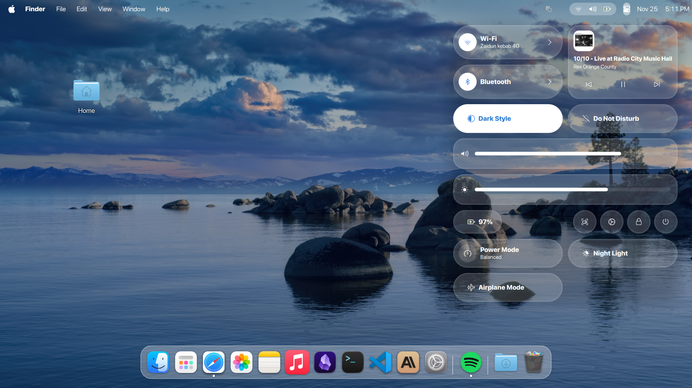
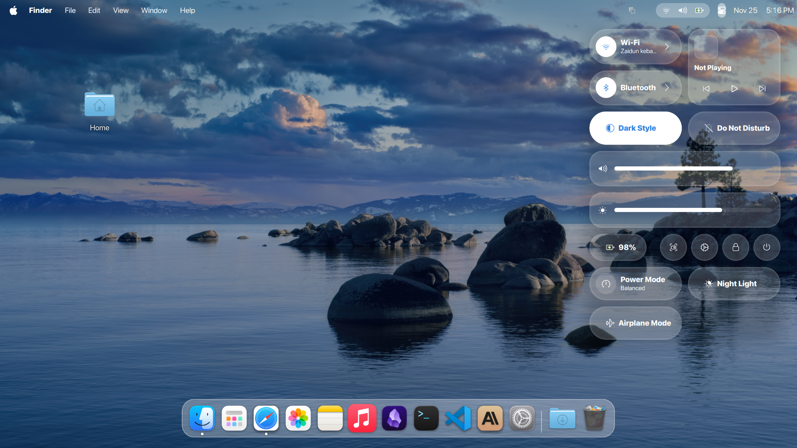

# Tahoe Control Center

A GNOME Shell extension that replaces the Quick Settings popup with a macOS Tahoe-style Control Center layout, including a live Now Playing music card.

Every control is the real GNOME control, reparented — not a clone. Disabling the extension restores the stock panel exactly.

> **Requires:** GNOME Shell 51 · GJS 1.90+ · `gnome-extensions` CLI

---

## Preview

| Music playing | No player |
|---|---|
|  |  |

---

## What it does

- **Tahoe layout** — grouped split block, tile rows, full-width sliders, round action buttons, overflow area.
- **Now Playing card** — title, artist, album art, prev / play-pause / next, driven by MPRIS. Reacts live to player start, stop, and track change.
- **Real controls** — Wi-Fi, Bluetooth, Dark Style, Do Not Disturb, volume, brightness, Power Mode, Night Light, Airplane Mode, and the screenshot / settings / lock / power buttons keep their original behaviour, sub-menus, and state sync.
- **Data-driven layout** — reorder blocks with a JSON override, no code edits.
- **Reversible** — `disable()` puts every moved actor back in its original parent, index, and column span. Idempotent.

---

## Layout

```
┌─────────────────────────────────┐
│  Wi-Fi        │  Now Playing    │
│  Bluetooth    │  ♫ Title        │
│               │  Artist  ◀ ⏯ ▶ │
├───────────────┴─────────────────┤
│  Dark Style  │  Do Not Disturb  │
├─────────────────────────────────┤
│  Volume  ══════════════════════ │
│  Brightness ═══════════════════ │
├─────────────────────────────────┤
│  📷  ⚙  🔒  ⏻                  │
├─────────────────────────────────┤
│  Power Mode  │  Night Light     │
│  Airplane Mode                  │
└─────────────────────────────────┘
```

Anything not claimed by the layout config flows into an overflow area at the bottom, so no control is ever lost.

---

## Install

```bash
# 1. Clone
git clone https://github.com/RizkyDaffy/mac-control-gnome.git
cd mac-control-gnome

# 2. Compile schemas + create symlink (does NOT enable in live session)
make schemas
make install
```

---

## Safe Testing (Nested Shell)

**Never run `make nested` from an SSH session or a Wayland compositor without a display.**

Open a terminal in your live desktop session:

```bash
make nested
```

This launches `gnome-shell --devkit` with an isolated dconf database.
Your live session is **not affected**.

---

## Enable (after testing passes)

```bash
gnome-extensions enable tahoe-control-center@local
# Log out and back in, or restart GNOME Shell (X11 only):
# alt+f2 → r → Enter
```

---

## Disable / Uninstall

```bash
# Disable (restores stock Quick Settings immediately)
gnome-extensions disable tahoe-control-center@local

# Full uninstall
make uninstall
```

### Emergency disable (if shell is frozen)

Switch to a TTY with **Ctrl+Alt+F3**, then:

```bash
gnome-extensions disable tahoe-control-center@local
```

Log back in with **Ctrl+Alt+F2**.

---

## Development

| Command | Purpose |
|---|---|
| `make test` | Run pure-logic unit tests (99 cases, no shell) |
| `make schemas` | Recompile GSettings schema |
| `make install` | Symlink src/ into extension dir |
| `make nested` | Safe nested shell for visual testing |
| `make logs` | Tail TahoeCC log lines from journal |
| `make pack` | Build distributable `.zip` |
| `make clean` | Remove build artifacts |

### Rollback any change

```bash
git log --oneline        # find the target commit
git reset --hard <hash>  # reset to it
make schemas && make install
```

---

## Project structure

```
src/
├── extension.js          Entry point — enable/disable with fatal-error guard
├── prefs.js              Adw preferences window
├── metadata.json         Extension manifest
├── stylesheet.css        Structural CSS (theme provides the visuals)
├── schemas/              GSettings schema
└── lib/
    ├── controller.js     Orchestrates enable/disable and layout passes
    ├── registry.js       Shell-internals access, isolated in one place
    ├── reparent.js       Actor move/restore helpers
    ├── layoutConfig.js   Default layout + JSON override parsing
    ├── layoutPlan.js     Pure block/tile placement logic
    ├── controlCenter.js  Popup restructuring
    ├── submenus.js       In-flow sub-menu hosting
    ├── musicCard.js      Now Playing card widget
    ├── mpris.js          MPRIS player watcher
    ├── mprisMetadata.js  Metadata normalisation (pure)
    ├── playerSelection.js Active player choice (pure)
    ├── artCache.js       Album art fetch + cache
    ├── dndFallback.js    Do Not Disturb tile fallback
    ├── conflicts.js      Known conflicting extension detection
    ├── disposables.js    Signal/timeout bookkeeping
    └── debug.js          Logging and actor tree dump

tests/                    GJS unit tests + MPRIS fixtures
scripts/dev-shell.sh      Isolated nested shell launcher
scripts/leak-loop.js      enable/disable leak check
docs/                     Design, recon, and phase reports
preview/                  Screenshots used in this README
```

Design documents live in the repo root (`01-PRD.md` … `07-RISKS-AND-OPEN-QUESTIONS.md`).

---

## Customising the layout

Open **GNOME Extensions → Tahoe Control Center → Preferences → Custom layout JSON**.

Leave blank to use the default Tahoe layout.

Provide a JSON object with a `blocks` array to override.
Example (swap Dark Style / DND row order):

```json
{
  "version": 1,
  "blocks": [
    {"type": "split", "id": "connectivity", "stack": ["wifi", "bluetooth"], "music": true},
    {"type": "tiles", "id": "toggles", "items": ["dnd", "dark-style"]},
    {"type": "slider", "id": "volume", "items": ["volume-output"]},
    {"type": "slider", "id": "brightness", "items": ["brightness"]},
    {"type": "circles", "id": "actions", "items": ["system-item"]},
    {"type": "tiles", "id": "extras", "items": ["power-mode", "night-light", "airplane-mode"]},
    {"type": "overflow", "id": "overflow", "items": []}
  ]
}
```

---

## Settings

| Key | Default | Description |
|---|---|---|
| `music-card-enabled` | `true` | Show Now Playing card |
| `fetch-remote-art` | `true` | Fetch album art over HTTPS |
| `show-battery-pill` | `false` | Show battery % pill (P2) |
| `layout-json` | `""` | Custom layout JSON (empty = default) |
| `debug` | `false` | Verbose logging + actor tree dump |

---

## Compatibility

- GNOME Shell 51 (Ubuntu 26.04 / Fedora 42+)
- Works with MacTahoe light/dark themes
- Multi-monitor and HiDPI (100 / 150 / 200%)
- Wayland and X11

**Known conflicts:** `quick-settings-tweaks@qwreey` — both modify the Quick Settings grid. A warning is logged; disable one to avoid visual glitches.

---

## Recovery

The extension wraps `enable()` in a try/catch.
On any fatal error it calls `disable()` immediately, restoring stock Quick Settings.

Logs: `journalctl -f /usr/bin/gnome-shell | grep TahoeCC`

---

## License

Not specified yet.
